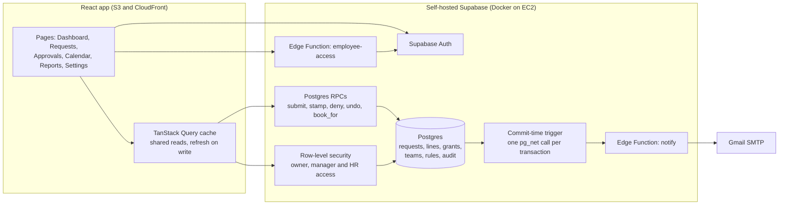

# Chartwells PTO

A paid-time-off app for a 30-person university dining department. It replaced HR's email and whiteboard process with one place to request time off, approve it and see who is off. Every leave rule runs inside the database, so Postgres refuses a request that breaks policy no matter which screen or script sent it.

Built for the Chartwells Higher Education dining team at the University of Utah. Kitchen staff use it on their phones during a shift. Managers and HR use it in the back office.

| | |
|---|---|
| Record | every request, decision, note and rejection reason in one place |
| Rules | enforced in Postgres, not in the browser |
| Email | the right people get one on every submit and decision |

---

## The problem

Time off ran through email and a whiteboard in the office. Approvals lived in inboxes, so there was no shared record of what was decided or why. Coverage lived on the board, so managers checked for overlaps by eye. Balances, blackout weeks and holiday rules had no single place where everyone could see them.

## What the app does

1. **Requests.** Staff book one or more ranges of time off in one form. The database checks each range against the person's schedule, holidays, balance, booking windows, blackout dates, overlapping requests and the leave year.
2. **Two-stamp approval.** Every request has a slot for the team manager and a slot for HR. The app grants it once both slots are settled. Either one can deny, and a denial stands unless someone undoes it. When nobody can fill a slot, such as a manager's own request with no co-manager, that slot settles on its own.
3. **Who's off.** The dashboard opens on a team timeline for the week or month, so coverage is the first thing people see.
4. **Balances and leave years.** Each leave type has its own leave year with a reset day HR can set. A balance is the person's grants minus their booked days.
5. **Holiday day off.** Each holiday opens a 30-day window in which a person can book one working day against it.
6. **HR tools.** HR can book time off for someone else, create accounts, edit people and teams, set PTO types and blackouts, and export reports to CSV.
7. **Email.** Managers and HR get an email about each new request. The requester gets one when someone approves, denies or reverses a decision.

---

## Architecture



The code has three layers:

- `src/` is the React 18 and Vite frontend. Screens render and call the data source, nothing more. TanStack Query holds server data. It makes one request when several screens need the same data, refreshes the screens a write affects, keeps the current data visible during a background refresh and blocks double submits.
- `supabase/migrations/` is the database, which stores every record and enforces every rule. Writes go through validated RPCs, reads go through row-level security, and each submit and decision adds an audit row. Each migration since September has a rollback file.
- `supabase/functions/` holds two Edge Functions. `employee-access` creates accounts and resets temporary passwords with the service-role key, which never reaches the browser. `notify` decides who gets each email and sends it.

---

## How the rules work

**1. The database validates every request.** `submit_request` calls `assert_request_valid`. It checks working days from the person's schedule, holidays, overlaps with pending or approved requests, the remaining balance, booking windows, blackouts and leave-year boundaries. A form with several ranges goes through `submit_requests` in one transaction, so either every range saves or none does.

**2. Row-level security limits what each person reads.** Active staff can read the roster, the configuration and who is off. Only the owner, that person's managers and HR can read a request's details and the owner's grants. `who_is_off` and `team_coverage` return the shared calendar view without notes, reasons or stamps.

**3. Approvals are stamps, not overwrites.** Each request has two stamp slots that record who stamped and when. The RPCs reject self-approval and stale decisions. Undoing a denial or taking back an approval is a separate action in the audit log, labelled with the account that did it.

**4. Email goes out at commit.** A trigger collects every submit and decision in a transaction and makes one `pg_net` call to `notify` when the transaction commits. A rolled-back change sends no email. `plan.ts` decides who gets what, `email.ts` builds the message and `send.ts` is the only file that knows the mail provider. If a send fails, the app logs it and keeps the approval.

---

## Tech stack

- React 18, Vite, Tailwind CSS, React Router, TanStack Query, Recharts and date-fns on the frontend
- Supabase (Postgres, Auth and Edge Functions in TypeScript), PL/pgSQL RPCs, row-level security and `pg_net` on the backend
- Gmail SMTP through the `notify` Edge Function, with a test mode that sends every email to one inbox
- AWS S3 and CloudFront for the frontend, self-hosted Supabase in Docker on EC2, and deploys through AWS Systems Manager
- Node's test runner, PGlite (Postgres compiled to WebAssembly) to run the real migrations, and a local fixture server shaped like Supabase for browser checks

---

## Project structure

```
src/
├── pages/                  # Dashboard, MyRequests, Approvals, CalendarPage, Reports, Settings, Profile
├── components/             # requests/, team/, calendar/, dashboard/, settings/, layout/, ui/
├── data/
│   ├── supabaseDataSource.jsx  # every table read and RPC call
│   └── mappers.jsx             # database rows to UI records
├── context/                # Auth, Org, Catalog, DataVersion
├── hooks/useResource.jsx   # connects screens to the query cache
├── lib/queryClient.js      # shared reads and refresh on write
└── utils/                  # policyEngine, leaveYear, holidayDayOff, whosOff, csv

supabase/
├── migrations/             # schema, RLS and RPCs; changes since September have a _rollback.sql
└── functions/
    ├── employee-access/    # account creation, temporary-password reset
    └── notify/             # plan.ts, email.ts, send.ts

tests/                      # database (PGlite), notify, notifications, frontend, query cache
scripts/deploy-aws.mjs      # deploy with target checks, backups and --dry-run
```

---

## Getting started (development)

Use Node.js 22 or newer and pnpm 11.

```sh
pnpm install --frozen-lockfile
cp .env.example .env.local
# Set VITE_SUPABASE_URL and VITE_SUPABASE_ANON_KEY in .env.local
pnpm dev
```

Only the public anon key goes in Vite variables. Service-role keys stay on the server.

```sh
pnpm check   # source checks
pnpm test    # database, function and frontend tests
pnpm build
```

### Try it without a Supabase project

```sh
pnpm test:fixture
# In another terminal:
VITE_SUPABASE_URL=http://127.0.0.1:54321 VITE_SUPABASE_ANON_KEY=fixture-anon-public-key pnpm dev
```

Sign in as `jordan@example.test` with any password. The fixture is an in-memory test server shaped like Supabase. Its data resets when it restarts, and it is never deployed.

### Backend and deployment

[supabase/README.md](supabase/README.md) covers database setup, roles, notification settings and maintenance. `scripts/deploy-aws.mjs` deploys the app, and `--dry-run` checks the targets without changing anything. A real run builds the app, copies each Edge Function folder to the server, restarts the functions container, backs up `index.html`, uploads hashed assets to S3, publishes the new index and clears the CloudFront cache. It keeps old hashed assets so cached pages still load, and it rolls back a function swap that fails.

---

## Testing

- The database tests run the real migrations in PGlite. They then submit, stamp, deny and undo requests, book for others, check leave years and read data as each role to check row-level security.
- The `notify` tests cover who gets which email, the HR recipient setting, test mode and sending at commit through a `pg_net` stub that records calls.
- The frontend tests cover shared reads and refresh, failed writes, bulk decisions where some fail, dates and schedules, and CSV escaping for quoted cells and spreadsheet formula prefixes.

---

## Design decisions

- **The database enforces the rules.** Validation lives in RPCs, not in React. A request from the app, a script or a future mobile client meets the same checks, and the UI can't drift from policy.
- **Coverage before balances.** The dashboard opens on who is off, because that is what managers check first.
- **Rules shown before submit.** The form shows which rule a request breaks before it is sent. Status uses an icon as well as a color, so it is readable at a glance on a kitchen floor.
- **Schema changes that can be undone.** Each migration since September has a rollback file and was written to run on the live schema.
- **Email failures don't block work.** Notifications go out at commit as best effort, so a mail outage never stops an approval.
